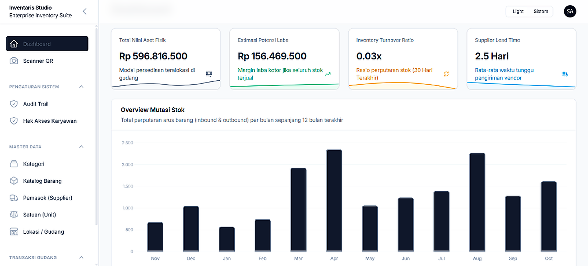

# 📦 Sistem Manajemen Inventaris Enterprise (Shadcn Admin UI)

Sistem Manajemen Inventaris (Inventory Management System) skala _enterprise_ yang dibangun dengan menggunakan **Laravel 13, Filament v3, Tailwind CSS v4, dan MySQL**, dipercantik dengan sentuhan **Shadcn Admin Design System** (`satnaing/shadcn-admin`). Aplikasi ini dirancang untuk mencatat pergerakan barang, menganalisis ketersediaan stok, menangani retur, hingga memprediksi rasio perputaran barang di multi-gudang secara akurat, modern, dan real-time.

---

## 📸 Preview Tampilan Aplikasi (HD)

<p align="center">
  <b>Dashboard Enterprise (Shadcn-Admin & Overview Mutasi Stok 12 Bulan)</b><br>
  
</p>

---

## 🎨 Tampilan & UI/UX (Shadcn Admin Design System)
*   **Palet Slate OKLCH & Inter Typography:** Tampilan profesional dengan kontras tinggi, font Inter, dan radius sudut 0.625rem (`rounded-xl`).
*   **16rem Collapsible Sidebar:** Sidebar navigasi modular yang dapat disederhanakan menjadi mini-rail ikonik secara instan di layar desktop.
*   **Sticky Blurred Topbar:** Header sticky dengan efek `backdrop-blur-md` dan garis pembatas halus.
*   **3-Way Dark / Light / System Mode:** Dukungan tema gelap dan terang terintegrasi penuh pada seluruh halaman, tabel data, modal, dan grafik.
*   **Command Palette (`⌘K` / `Ctrl+K`):** Navigasi dan pencarian global instan dari mana saja menggunakan keyboard.

---

## 🚀 Fitur Unggulan

### 1. Manajemen Katalog & Multi-Gudang 
Kelola data barang dan distribusikan stoknya di berbagai gudang yang berbeda. Modul Master Data mencakup:
- **Katalog Barang**: Pencatatan profil lengkap produk (SKU, Harga, Batas Stok).
- **Kategori & Satuan**: Pengelompokan jenis barang dan pengaturan Satuan (Pcs, Box, Kg, Liter, dll).
- **Pemasok (Supplier)**: Database pemasok lengkap dengan narahubung dan kontak.
- **Lokasi Gudang**: Pengaturan alamat multi-cabang.

### 2. Transaksi & Mutasi Keamanan Tinggi
Sistem transaksi dengan validasi *real-time* yang mustahil menyebabkan stok minus:
- **Barang Masuk (Inbound)**: Pencatatan kedatangan stok.
- **Barang Keluar (Outbound)**: Pencatatan penjualan/distribusi. Sistem otomatis memblokir transaksi jika kuantitas melebihi stok yang ada.
- **Retur Barang**: Fasilitas `Retur Masuk` (dari pelanggan) dan `Retur Keluar` (ke pemasok).
- **Transfer Stok**: Perpindahan stok antar gudang dengan pencatatan mutasi ganda secara otomatis.
- **Stock Opname**: Pencocokan stok fisik dan sistem. Selisih langsung dieksekusi sebagai 'Adjustment'.
- **Scanner QR Code**: Generate QR Code secara otomatis, dan gunakan kamera scanner di dalam aplikasi untuk melakukan mutasi tanpa perlu mengetik manual.

### 3. Dashboard Analitik & Metrik Cerdas
- **Low Stock Alert**: Peringatan otomatis apabila stok barang berada di bawah batas minimum (ditandai dengan _badge_ warna merah).
- **Estimasi Keuangan**: Perhitungan otomatis Total Nilai Aset (stok mengendap) dan Estimasi Potensi Laba.
- **Tren Mutasi Stok (Line Chart)**: Melihat pergerakan keluar-masuk stok.
- **Fast-Moving Products (Bar Chart)**: Mengetahui 5 barang paling cepat habis.
- **Inventory Turnover Ratio**: Mengukur rasio perputaran persediaan dalam 30 hari terakhir.
- **Dead Stock Analysis (Tabel)**: Mendeteksi barang yang tidak ada pergerakan atau lambat terjual.

### 4. Keamanan & Route Obfuscation (Admin Hardening)
- **Configurable Panel Path:** URL panel manajemen Filament tidak menggunakan path umum (`/admin`), melainkan dikonfigurasi melalui environment variable `ADMIN_PREFIX` di `.env` (default: `inventaris-portal-mgmt`).
- **Anti-Scanning Protection:** Upaya akses langsung ke `/admin` otomatis mengembalikan status **HTTP 404 Not Found**, menyamarkan endpoint panel administrasi dari bot scanner dan serangan brute-force.
- **Transisi Otentikasi Terenkripsi:** Redirect root `/` secara dinamis menuju path rahasia yang terkonfigurasi.

### 4. Enterprise Security & Reliability (Keamanan)
- **Role-Based Access Control (RBAC)**: Memisahkan hak akses antara `Admin` (memiliki kendali penuh CRUD) dan `Staff Gudang` (hanya bisa menambah transaksi, tidak bisa mengedit master data).
- **Audit Trail (Log Aktivitas)**: Mencatat seluruh aktivitas user (Login, Logout, Gagal Login, Tambah/Edit/Hapus Data) secara diam-diam, dilengkapi dengan pelacakan _IP Address_ dan _User Agent_.
- **Soft Deletes**: Fitur keamanan anti data hilang. Tabel krusial (Produk dan Transaksi) yang dihapus tidak benar-benar dihapus dari database, dan dapat di-*restore* kembali kapan saja oleh Admin.
- **Export & Import**: Mendukung bulk-import barang via CSV/Excel untuk mempermudah migrasi data.

---

## 🛠️ Prasyarat (Requirements)
- **PHP** 8.3+
- **Composer**
- **Node.js** & NPM
- **MySQL** / MariaDB

---

## 📦 Panduan Instalasi (Development)

1. **Clone repositori ini:**
   ```bash
   git clone https://github.com/pranataa-labs/Inventory-Management-System.git
   cd Sistem-Manajemen-Inventaris
   ```

2. **Salin dan atur file Environment:**
   ```bash
   cp .env.example .env
   ```
   *(Buka file `.env`, pastikan `DB_CONNECTION=mysql` dan isi nama `DB_DATABASE` sesuai dengan yang ada di sistem MySQL Anda).*

3. **Install Dependensi:**
   ```bash
   composer install
   npm install && npm run build
   ```

4. **Generate Application Key:**
   ```bash
   php artisan key:generate
   ```

5. **Jalankan Migrasi dan Seeder:**
   ```bash
   php artisan migrate:fresh --seed
   ```

6. **Jalankan Storage Link (Untuk QR Code / Gambar):**
   ```bash
   php artisan storage:link
   ``` 

7. **Jalankan Server Lokal:**
   ```bash
   php artisan serve
   ```
   Aplikasi dapat diakses di `http://localhost:8000/admin`. Halaman depan (`/`) akan otomatis di-redirect ke panel Admin.

---

## 🔑 Akun Uji Coba (Dummy)
Gunakan kredensial berikut untuk menguji coba limitasi otorisasi (RBAC):

| Role | Email | Password | Hak Akses |
| --- | --- | --- | --- |
| **Super Admin** | `admin@inventory.test` | `password` | Bebas akses ke semua modul dan sistem. |
| **Staff Gudang** | `staff@inventory.test` | `password` | Terbatas. Hanya bisa _view_ katalog, tambah mutasi stok, & scanner QR. |

---

*Dibuat oleh [pranataa-labs](https://github.com/pranataa-labs).*
